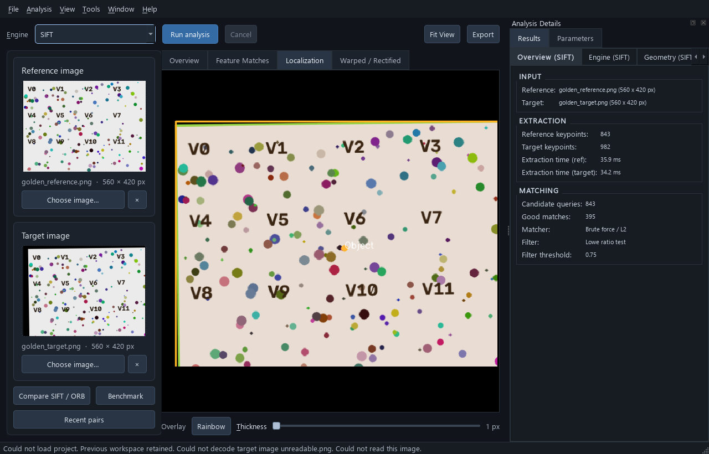
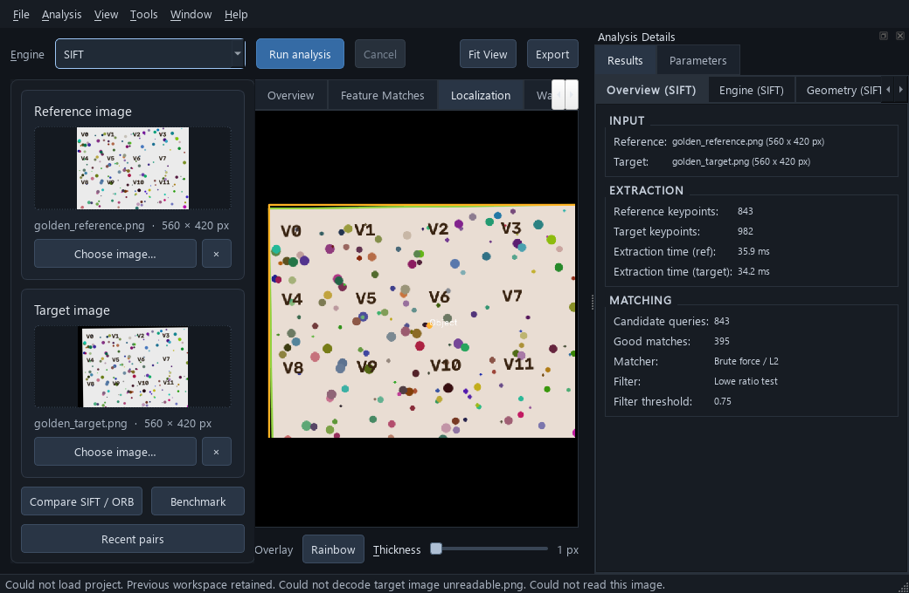

# Source image-workflow review — 2026-10-26

Source `21c1ec8`. These are unedited Qt offscreen/software renders, not native desktop screenshots. The reference/target are the repository's synthetic golden fixtures. A real SIFT analysis is retained while opening a new ORB project whose target cannot decode. Assertions verify that the old result object, image pair, SIFT selection and previous document identity remain unchanged.

The review explicitly loads the installed Windows Segoe UI font at 10 points. The first harness attempt used the offscreen default font and produced missing glyphs; that attempt is excluded from layout acceptance. This controlled-font review does not prove native-platform font selection, keyboard focus, screen-reader announcements or monitor scaling. It creates no visible OS window and uses isolated settings under ignored build storage, with CUDA masked and software rendering selected.

At both requested/actual sizes the primary actions, image roles, filenames, dimensions and retained-result details are readable. Cached previews fit their label bounds; the canvas remains in automatic fit mode. At minimum width, result tabs expose scroll controls rather than requiring all labels to fit simultaneously. Native focus/contrast/scaling review of those controls remains part of I14. Timing values shown are a single local execution, not a portable performance benchmark.

## 1280 × 820

## 1040 × 680

[Source/input/image hashes and measured widget bounds](review.json). [Product quality standard and remaining native gates](../../PRODUCT_QUALITY_STANDARD.md).
